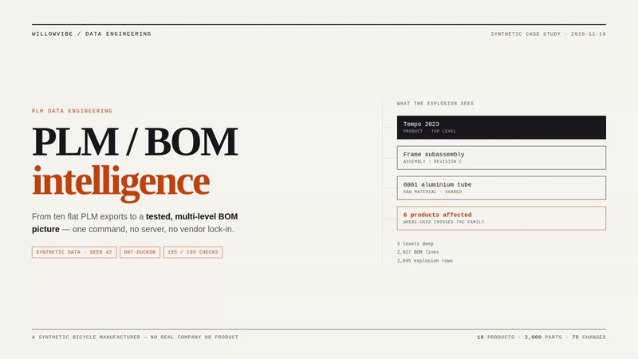
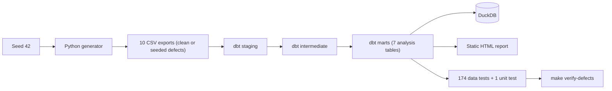

# plm-bom-pipeline

[](https://github.com/willowvibe/plm-bom-pipeline/actions/workflows/ci.yml)
[](LICENSE)

[](https://willowvibe.github.io/plm-bom-pipeline/#demo)

**[Live demo](https://willowvibe.github.io/plm-bom-pipeline/#demo)** · **[Static report](https://willowvibe.github.io/plm-bom-pipeline/report/)** · **[dbt docs](https://willowvibe.github.io/plm-bom-pipeline/dbt-docs/)**

**Your PLM data — parts, BOMs and change orders — flowing into governed, tested analytics in one command.**

Synthetic PLM data — parts, multi-level BOMs and ECR/ECO/ECN change control — generated deterministically for testing analytics.

This repository contains a small, standard-library-only Python generator for a fictional bicycle manufacturer's product lifecycle data. It writes 3 product families, 18 products, exactly 2,000 parts, revision histories with effectivity dates, five-level bills of material, ECR → ECO → ECN change records with approvals, suppliers and a synthetic ERP BOM extract. Every file is derived from one integer seed, all tables are sorted by primary key, and dates come from fixed arithmetic rather than the clock — so the same seed produces byte-identical files. Seven independently switchable defects model common PLM data-quality problems.

Built and maintained by [WillowVibe](https://www.willowvibe.com). Planning a Windchill or Teamcenter migration? See our [PLM migration readiness check](https://www.willowvibe.com/services/plm-data-migration).

## Built from scratch on synthetic data

All companies, products, suppliers, costs, dates and change records are fabricated. No client or production data is used. The generator models generic PLM concepts only.

## Architecture



The generator is the only source of data. dbt reads the CSVs in place through `external_location`, so there is no separate load step; the marts and tests build into `data/plm.duckdb`, and the report reads that database plus `dbt/target/run_results.json`. See [`docs/architecture.md`](docs/architecture.md) for component responsibilities, contracts and design decisions.

## Quickstart

Requires Python 3.11+ and `make`. The generator uses only the standard library; the dbt build and report need the development requirements.

```bash
python3 -m venv .venv-dbt
. .venv-dbt/bin/activate
pip install -r requirements-dev.txt

make demo             # generate clean data, dbt build + tests, write the report
make verify-defects   # prove each seeded defect fails exactly its own test
```

`make demo` typically takes 15–20 seconds on a laptop and writes `data/raw`, `data/plm.duckdb` and `site/report/index.html`.

Generator-only commands work with the standard library alone:

```bash
python -m generator --out data/raw --seed 42 --defects none
python -m generator --out data/raw-messy --seed 42 --defects all
python -m generator --out data/raw --defects cyclic_bom,orphan_parts
```

`make data`, `make messy` and `make test` wrap the first two commands and pytest. The Makefile uses `python3` by default (`make PYTHON=python data` is supported). Generated raw data and DuckDB files are ignored by git.

## dbt models

The dbt project in `dbt/` reads the generated CSVs in place with DuckDB and builds the staging, intermediate and mart layers into `data/plm.duckdb` (gitignored). Sources use dbt-duckdb's `external_location`, so there is no separate load step.

```bash
# using the virtualenv from Quickstart (requirements-dev includes dbt-duckdb)
make dbt             # generate data, then build every layer and test
make dbt-docs        # generate the dbt docs site
make report          # build dbt, then write site/report/index.html
make verify-defects  # prove defect attribution and built-in test health
```

`make dbt` runs a full `dbt build` from the repository root (it also passes absolute `PLM_RAW_DIR` and `PLM_DUCKDB_PATH` paths). To run dbt directly, the same command works from the repository root:

```bash
dbt build --project-dir dbt --profiles-dir dbt
dbt build --select int_bom_explosion --project-dir dbt --profiles-dir dbt \
  --vars '{as_of_date: "2025-01-01"}'
dbt docs generate --project-dir dbt --profiles-dir dbt
```

Layers:

- **staging** — one typed, renamed view per CSV (`stg_*`), enums lower-cased.
- **intermediate** — `int_current_revisions` (released revision per part as of the `as_of_date` var, default `2026-06-01`), `int_bom_explosion` (recursive BOM explosion with a cycle guard and accumulated quantities) and `int_where_used` (direct parent and product usage).
- **marts** — seven analysis tables in the `main_marts` schema:

| Mart | Grain | Contents |
|---|---|---|
| `bom_explosion` | product traversal path | Explosion enriched with names, part type/UoM, cost, weight, `extended_cost` and `is_leaf`. |
| `bom_cost_weight_rollup` | product | `total_cost`, `total_weight_kg`, `bom_line_count`, `max_depth` over leaf parts only. |
| `where_used` | child/parent/product | Direct where-used with child and parent part names and product name. Family-shared raw materials appear under all six products in their family. |
| `eco_cycle_time` | change | Approval/close dates, null-safe day counts and `cycle_status`. |
| `change_impact` | change/product | Distinct products affected through the BOM or as the top-level part. Changes on a family-shared raw material affect all six products in the family. |
| `part_reuse` | part | `direct_parent_count`, `product_count`, `total_direct_quantity`; the nine family-shared raw materials reach six products and the other 1,991 parts reach one. |
| `bom_erp_reconciliation` | parent/child part number | Full outer join of PLM and ERP BOMs with quantities, UoMs, delta and `reconciliation_status`. |

The `int_bom_explosion` unit test is a hand-checked three-level fixture with known quantities; run it with `dbt test --select int_bom_explosion --project-dir dbt --profiles-dir dbt`.

## Static report

`make report` builds the dbt project and writes `site/report/index.html`, a self-contained page with inline CSS and no JavaScript, fonts, images or CDN assets. It opens directly from the filesystem or from any static host. The builder reads `data/plm.duckdb` read-only and parses `dbt/target/run_results.json` for the quality section, so `duckdb` must be available in the Python environment used for the command:

```bash
make report
# or, without activating the venv:
make report PYTHON=.venv-dbt/bin/python DBT=.venv-dbt/bin/dbt
```

The page covers BOM structure, change-control cycle times, cross-product change impact, part reuse, the seven seeded defects and PLM ↔ ERP reconciliation. `make demo` is a one-command alias that regenerates the data, builds dbt and writes the report.

## Data quality

`dbt/tests/` holds seven singular tests, one per seeded defect: `assert_no_cyclic_bom`, `assert_no_orphan_parts`, `assert_no_released_assembly_unreleased_child`, `assert_no_overlapping_revision_effectivity`, `assert_no_zero_or_negative_quantity`, `assert_no_uom_mismatch` and `assert_no_eco_closed_without_ecn`.

Each test returns zero rows on clean data and rows only when its own defect is present. `make verify-defects` proves that attribution end to end: it generates clean data, each defect alone and all seven together into temporary directories, and for each case runs a full `dbt build` plus a second build with the seven singular tests excluded. The first pass checks that clean has zero failures, each single defect fails exactly its own test, and `all` fails exactly seven. The second pass removes dbt's build gate and checks that all 188 built-in nodes still pass (20 model successes, 167 generic data-test passes and the 1 unit test), with no skipped models. The command accepts a dbt path, for example `make verify-defects DBT=.venv-dbt/bin/dbt`. See [`docs/defects.md`](docs/defects.md) for the defect-to-test table.

## What is generated

| File | Rows (clean, seed 42) | Contents |
|---|---|---|
| `families.csv` | 3 | Road, Mountain and City families |
| `products.csv` | 18 | Products and their top-level assembly |
| `parts.csv` | 2,000 | Assemblies, components and raw materials with standard cost and unit weight |
| `part_revisions.csv` | 2,502 | Released, in-work and superseded revisions |
| `boms.csv` | 2,027 | Multi-level parent/child BOM lines, including 45 family-shared links |
| `changes.csv` | 75 | ECR, ECO and ECN records |
| `change_approvals.csv` | 150 | Approval decisions per change |
| `suppliers.csv` | 40 | Fictional suppliers |
| `part_suppliers.csv` | 2,849 | Sourcing price and lead time |
| `erp_bom.csv` | 2,027 | Synthetic ERP BOM extract for later reconciliation |
| `defects.json` | — | Manifest of enabled defects and the exact rows they touched |

See [`docs/data-model.md`](docs/data-model.md) for keys, relationships, effectivity semantics and each defect switch.

## How we'd adapt this for your PLM

The data model and tests are deliberately vendor-neutral, so the integration work is concentrated in two places: the staging contract and the rules in `docs/data-model.md`.

- **Source** — replace `data/raw` with scheduled exports or API extracts from Teamcenter, Windchill, 3DEXPERIENCE or your own PLM. Keep the `stg_*` column names and types, or change the staging models in one layer.
- **PLM semantics** — map your revision states, effectivity rules (date, unit or lot), BOM release states and change workflow to the concepts used here. The recursive explosion, current-revision resolution and where-used models then carry over unchanged.
- **ERP reconciliation** — swap the synthetic `erp_bom.csv` for your ERP mBOM extract, keep the parent/child part-number join, and extend the status buckets if your part-number mapping needs it.
- **Warehouse** — replace the dbt-duckdb adapter with Snowflake, BigQuery, Postgres or Databricks. The models are plain SQL and do not depend on DuckDB-specific features apart from `external_location` in the staging sources.
- **Operations** — schedule dbt and the report from Airflow, Dagster or CI; add SSO, secrets management and alerting around the same tests.
- **Not included** — this repository has no vendor connector and no real PLM credentials. The demo is synthetic end to end, so the first engagement step is always a scoped export from your system.

## Roadmap

Milestone 1 is the deterministic generator and its test suite. Milestone 2 adds the dbt staging and intermediate layers. Milestone 3 adds the mart layer, the seven defect-specific data-quality tests and the exact-one-failure attribution harness. Milestone 4 adds family-shared raw materials and the static HTML report at `site/report/index.html`. Milestone 5 adds the development requirements and CI: a clean-checkout `make demo` is timed against a 120-second budget, and the defect harness runs on every dataset.

Milestone 6 was the README and docs audit. Milestone 7 publishes the landing page, the static report, the generated dbt docs and a narrated 1080p walkthrough to GitHub Pages; the GIF above is a short cut of that video. Milestone 8 tags `v1.0.0` and wires the project into the portfolio hub and the WillowVibe company site.

## License

MIT — see [LICENSE](LICENSE) for details. All data in this repository is synthetic and generated from seed 42; no client or production data is included.

## About

plm-bom-pipeline is an open-source project by [WillowVibe](https://www.willowvibe.com), a small data engineering and AI studio. Questions or project ideas: contact@willowvibe.com or [book a 30-minute call](https://cal.com/harishng/30min).
