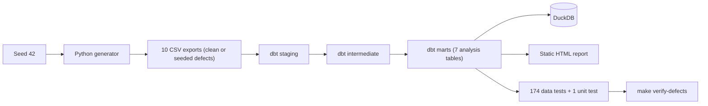

# Architecture

`plm-bom-pipeline` is a small end-to-end stack: a deterministic generator, a dbt project over the generated CSVs, a defect-attribution harness and a static report. It runs in-process on DuckDB, so there is no server, container or cloud dependency.

## Data flow

## Components

| Path | Responsibility |
|---|---|
| `generator/` | Builds the dataset from one integer seed and writes ten CSVs plus `defects.json`. Standard library only. |
| `dbt/models/staging/` | One typed, renamed view per CSV. Sources use dbt-duckdb's `external_location`, so CSVs are read in place. |
| `dbt/models/intermediate/` | Current released revision per part, recursive BOM explosion with a cycle guard, and direct where-used. |
| `dbt/models/marts/` | Seven analysis tables in `main_marts`: explosion, cost/weight rollup, where-used, ECO cycle time, change impact, part reuse and PLM/ERP reconciliation. |
| `dbt/tests/` | Seven singular tests, one per seeded defect. |
| `scripts/verify_defects.py` | Generates nine datasets and runs the two-pass attribution check described in [`defects.md`](defects.md). |
| `report/` | Reads the marts and `dbt/target/run_results.json`, then renders a self-contained HTML page. |
| `site/report/index.html` | The generated report, committed so a static host can serve it without a build step. |
| `tests/` | pytest coverage for generator invariants, determinism, defect switches and the report renderer. |
| `.github/workflows/ci.yml` | Tests, timed clean-checkout `make demo`, and the full defect harness. |

## Contracts

**Generator → dbt.** The ten CSVs have stable filenames and column names documented in [`data-model.md`](data-model.md). `PLM_RAW_DIR` points the dbt sources at a dataset directory; `PLM_DUCKDB_PATH` chooses the database file. Both default to the repository-relative paths used by the documented direct dbt invocation.

**dbt → report.** The report reads only `main_staging`, `main_marts` and `run_results.json`. It does not import dbt or re-derive metrics. That keeps the displayed numbers tied to the build that passed the tests.

**Defects → tests.** Each defect switch records the exact rows it mutated in `defects.json`. The harness compares that manifest with the failing dbt nodes, so a test that fails for the wrong reason is caught.

## Design decisions

- **DuckDB in-process.** A visitor can go from clone to marts and report without Docker or a warehouse account. The SQL stays portable enough to move to Snowflake, BigQuery or Postgres by changing the adapter and the staging source.
- **A generator, not a checked-in dataset.** The CSVs are reproducible from the seed, small enough to regenerate in a second, and carry no client or personal data. Committing only the generator also makes the determinism claim testable.
- **Singular tests for defects.** A generic test would need parameters per defect; one named SQL test per defect makes the defect-to-test mapping explicit and keeps the built-in generic tests independent of defect behavior.
- **Two passes in the harness.** A failed singular test gates downstream dbt nodes, so a single build cannot show whether the built-in tests still pass on defective data. The second build excludes the seven singular tests and proves all 188 built-in nodes stay green.
- **Shared raw materials.** Real PLM reuses parts across products. Three shared raw materials per family make `where_used`, `part_reuse` and `change_impact` exercise multi-product reach instead of trivially returning one product per part.
- **Report with no runtime.** Inline CSS and no JavaScript means the page works from the filesystem, from GitHub Pages and in print, with no asset pipeline to break.

## Limits

- No vendor PLM connector, CAD geometry, authentication or orchestration is included. The integration points are described in the README's "How we'd adapt this for your PLM".
- The ERP extract is a part-number projection of the PLM BOM rather than an independently corrupted system, so cross-system reconciliation defects are a later concern.
- The report is a snapshot of one build. It is regenerated by `make report`; it is not a live dashboard.
